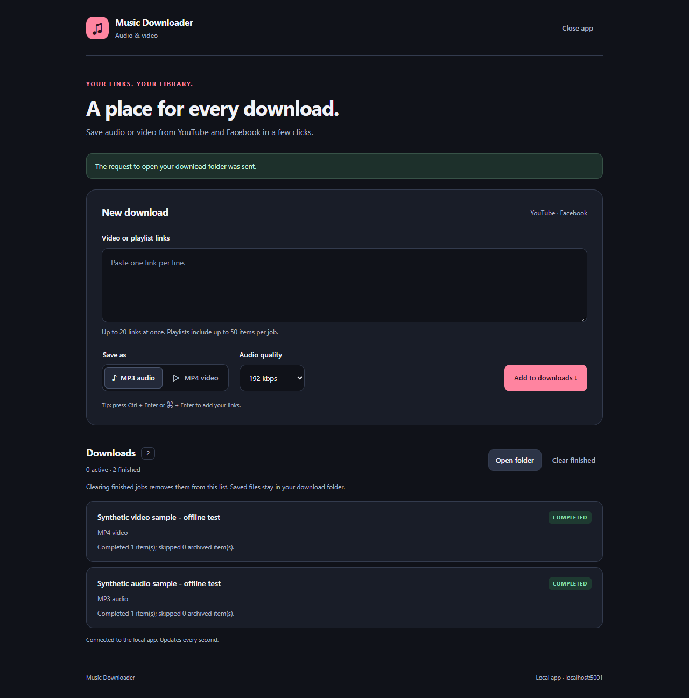
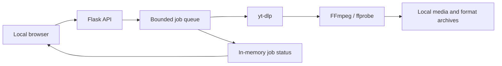

# Music Downloader

A local web interface for saving supported YouTube and Facebook links as MP3
audio or MP4 video. Built with Python, Flask, yt-dlp and plain JavaScript.
The application listens on `127.0.0.1:5001`; media and download history stay on
the computer running it.

Use media you own or have permission to download. The application does not load
browser cookies, sign in to accounts, or bypass DRM.



*Offline interface demonstration using generated job results; no real media was downloaded.*

## Features

- An English interface with audio quality selection and live job progress.
- MP3 extraction at 128, 192, 256 or 320 kbps and MP4 video merging/remuxing.
- Separate audio/video archives and output folders; duplicate active jobs are skipped.
- YouTube video, Shorts, live-video and explicit playlist links; supported Facebook
  video, reel and short links. Account-only content is outside the scope.
- Up to 20 links per submission, 200 retained jobs, and the first 50 entries of an
  explicit playlist. A video URL containing `list=` still downloads one video.
- Loopback binding, Host/Origin checks and per-session API request tokens.
- Offline tests for API validation, queue behavior and download outcomes.



## Requirements

- **Python 3.11+**; the development checks use Python 3.12 on Windows.
- **FFmpeg and ffprobe**, installed together and available on `PATH`. Windows
  executable users can also place both tools beside `MusicDownloader.exe`.
  Get them through the [official FFmpeg download page](https://ffmpeg.org/download.html).
- For YouTube: **Deno 2.3+ or Node.js 22+** on `PATH`. The app selects Deno first,
  then Node. See the upstream [yt-dlp EJS setup guide](https://github.com/yt-dlp/yt-dlp/wiki/EJS).
  The Python requirements install yt-dlp's matching EJS scripts.

Python packages are pinned in `requirements.txt`. No launcher silently upgrades
packages or downloads external executable tools.

## Run from source

```bash
git clone https://github.com/salihcagdas-ai/music-downloader.git
cd music-downloader
```

On Windows, use PowerShell:

```powershell
python -m venv .venv
.\.venv\Scripts\python.exe -m pip install -r requirements.txt
.\.venv\Scripts\python.exe app.py
```

On macOS or Linux:

```bash
python3 -m venv .venv
.venv/bin/python -m pip install -r requirements.txt
.venv/bin/python app.py
```

The browser opens at <http://127.0.0.1:5001>. Paste one link per line, select a
format and choose **Add to downloads**. `Ctrl+Enter` / `Cmd+Enter` also submits the list.
The page stays usable without FFmpeg, but a download request reports the missing
dependency. Install it and restart the application before downloading.

After the initial setup, `run.ps1` on Windows or `./run.sh` on macOS/Linux starts
the same application. Pass `-NoBrowser` to the PowerShell launcher, or
`--no-browser` to Python / the shell launcher, to keep the browser closed.

The optional **Music Downloader.app** macOS launcher must remain beside `app.py`
and uses the same `.venv`; it is not a self-contained, signed or notarized app.
macOS and Linux launchers have not been executed on their target platforms in
this maintenance pass.

## Local files and queue behavior

```text
downloads/
  audio/                  MP3 files
  video/                  MP4 files
archive-audio.txt         Completed audio IDs
archive-video.txt         Completed video IDs
music-downloader.log      Launcher / packaged-app diagnostics, when applicable
```

These files are ignored by Git. Keep personal link lists and cookies out of the
repository; `local-inputs/` is also ignored for local working files.

Jobs live in memory and reset when the app restarts. Finished media and archive
files persist. **Clear finished** removes only completed, skipped and failed
rows; it never deletes media. The archive is per format, not per audio quality:
requesting a different bitrate for an archived item still skips it. Removing an
archive entry allows a new attempt, but existing files are not overwritten.

The worker pool has three workers. Jobs of the same format run serially to avoid
archive and output-file races; audio and video can run concurrently when workers
are available. Completed rows are pruned when necessary to keep the job list
within its limit. Active jobs are never evicted.

**Close app** refuses to close while jobs are active. Wait for the queue to finish;
the button then stops the local server. Closing the browser tab alone does not
stop the application. There is no per-job cancellation or disk-quota feature.

## Development and Windows packaging

Use the Python executable from the virtual environment:

```bash
python -m pip install -r requirements-dev.txt
python -m pytest
python -m ruff check .
python -m ruff format --check .
python -m pip check
```

Browser-logic tests need Node.js 22+ and no npm packages:

```bash
node --test tests-ui/app.test.mjs
```

On Windows, build the optional executable:

```powershell
.\.venv\Scripts\python.exe -m pip install -r requirements-build.txt
.\.venv\Scripts\python.exe scripts/build_windows.py
```

Output: `dist/MusicDownloader.exe` and dependency notices. Keep the executable
in a writable folder with `THIRD_PARTY_NOTICES/` and `THIRD_PARTY.md`.
It still needs FFmpeg, ffprobe and a supported JavaScript runtime; these tools
are not bundled. Python itself is included by PyInstaller.

The **Build Windows application** workflow is manually started from GitHub
Actions. It runs the offline checks and creates a short-lived artifact; it does
not create a release or start automatically on push. See [third-party components](THIRD_PARTY.md).

## Project layout

| Path | Responsibility |
| --- | --- |
| `app.py` | URL validation, local API, queue, download workers and lifecycle |
| `templates/index.html` | Accessible page structure and request token |
| `static/` | Browser behavior and responsive styles |
| `tests/` | Isolated backend tests with fake downloaders and temporary files |
| `tests-ui/` | Browser logic tests using Node's built-in test runner |
| `scripts/build_windows.py` | Executable build and dependency notice collection |
| `run.sh`, `run.ps1`, `Music Downloader.app/` | Launchers for an already configured checkout |

## Limits and verification

Offline tests use synthetic downloader results and do not download real media.
They check application behavior, not ongoing YouTube/Facebook availability.
Site changes, authentication requirements, regional restrictions and rate limits
can still cause failures. Download speed and media quality are not benchmarked.

MP4 remuxing changes the container; it does not guarantee that every source codec
plays on every device. Audio bitrate selection also cannot restore quality absent
from the source. A playlist progress bar represents its current item, not a
measured percentage of the entire playlist.

This is a single-user desktop utility using a local development server. Do not
expose it through a public reverse proxy or change its loopback binding. Accepted
site URLs are restricted, but yt-dlp still makes outbound requests and follows
the supported sites' media redirects; this is not a sandbox for untrusted media.

To update extraction support, intentionally upgrade yt-dlp and its default
dependencies, then rerun the checks and record the new tested version:

```bash
python -m pip install --upgrade "yt-dlp[default]"
```

The installed version after this command can differ from the repository's pinned
version; update `requirements.txt` only after verification.
